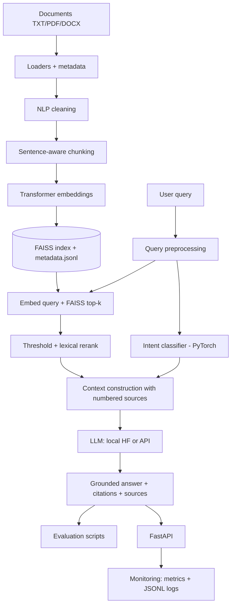

# IntelliRAG — Neural Document Intelligence & Retrieval-Augmented Generation Platform

An end-to-end, standalone document question-answering system: ingest TXT/PDF/DOCX files, embed chunks with a Hugging Face transformer, search them with FAISS, and generate **grounded, cited** answers with a local or API-based LLM — exposed through FastAPI with monitoring and an evaluation framework.

> **Status of results:** this repository contains source code only. No benchmark, accuracy, recall, latency or test results are included or claimed. Everything below tells you how to produce them yourself.

## 1. Problem statement
LLMs answer fluently but can invent facts. For private documents the answer must come from the documents and point back to them. IntelliRAG retrieves the relevant passages first, constrains the LLM to those passages, returns the sources, and refuses when the documents don't contain the answer.

## 2. Architecture


## 3. Key capabilities
- TXT/PDF/DOCX loaders with structured errors (no silent skips); page/section metadata
- Transformer-safe cleaning (no stop-word removal or stemming for embeddings)
- Sentence-aware chunking with configurable size/overlap
- Configurable embedding model, normalised vectors, FAISS cosine search, save/load with consistency checks
- Optional lexical reranking, similarity threshold, intent-adaptive `top_k`
- Prompted grounding rules; LLM is **never** called without retrieved context
- Local Hugging Face LLM or OpenAI-compatible API (key from environment only)
- Retrieval + generation evaluation, optional LLM judge
- Request/query/ingestion/latency/error metrics and JSONL event logs

## 4. Technology stack
Python · PyTorch · Hugging Face Transformers · FAISS · FastAPI/Pydantic · scikit-learn · pandas · NumPy · pypdf · python-docx · httpx · pytest · Docker.
Each has a concrete role: PyTorch (encoder inference + intent classifier), scikit-learn (splits, metrics, stop-word list for lexical tools), pandas (training/eval data), httpx (API LLM + test client).

## 5. NLP pipeline
`src/nlp/cleaning.py` (NFKC, quote straightening, control/zero-width removal, hyphenation repair, page-number lines, whitespace/paragraph normalisation) → `chunking.py` (rule-based sentence splitter with abbreviation handling; sentences packed up to `CHUNK_SIZE` words with `CHUNK_OVERLAP` words of whole-sentence overlap; over-long sentences split into word windows; chunks never cross pages/sections) → `preprocessing.py` (query normalisation, keyword extraction).

## 6. Transformer components
`TransformerEncoder` loads any `AutoModel` encoder, applies mean (or CLS) pooling over non-padding tokens and L2-normalises. Optional query/document prefixes support models such as E5/BGE. The LLM is a causal LM (`AutoModelForCausalLM`, chat template when available).

## 7. Embedding pipeline
Chunks → `encode_documents` (batched, no grad) → `FaissStore.add`. Queries → `encode_queries`. The embedding model name and dimension are stored in the index manifest; a mismatch raises an actionable error.

## 8. Vector search
`IndexFlatIP` over normalised vectors (= cosine similarity, exact search). Persisted as `index.faiss`, `metadata.jsonl` (document, chunk id, page, section, source path, text, keywords) and `manifest.json`, written atomically.

## 9. RAG pipeline
query → preprocess → (intent) → embed → search → drop below `MIN_SIMILARITY` → optional rerank → top-k → numbered context within `MAX_CONTEXT_WORDS` → prompt → LLM → parse `[n]` citations → answer + sources (`cited` flag per source).

## 10. LLM integration
`LLM_PROVIDER=local` uses `LLM_MODEL_NAME` via Transformers (lazy-loaded). `LLM_PROVIDER=api` calls `{LLM_API_BASE_URL}/chat/completions` with `LLM_API_KEY` from the environment. New providers implement `BaseLLM.generate` and register in `src/llm/__init__.py`.

## 11. Neural network component
Query-intent classifier (`src/neural`): frozen pretrained transformer features → trainable PyTorch MLP head (LayerNorm, GELU, dropout). Training pipeline with stratified train/val/test split, early stopping on validation loss, seeded runs, checkpoint save/load (`weights_only` safe), evaluation (accuracy, macro P/R/F1, per-class report, confusion matrix). Purpose in the system: widen retrieval for `summary`/`comparison` questions and tailor answer style. `data/training/intent_queries.csv` is a small seed set — extend it for real use. Metrics appear only after you train.

## 12. API
| Method | Path | Purpose |
|---|---|---|
| GET | `/health` | status, uptime, index size |
| POST | `/documents/ingest` | multipart upload → extract/clean/chunk (no embedding) |
| POST | `/documents/index` | embed processed chunks → FAISS (`{"rebuild": true}` to rebuild) |
| POST | `/query` | `{"question": "...", "top_k": 5}` → answer, sources, model, latency |
| GET | `/documents` | ingested documents + indexed chunk counts |
| GET | `/model/info` | configured/loaded models, retrieval config, index stats |
| GET | `/metrics` | counters, latency stats, recent errors, model versions |

Errors use `{"error": {"code", "message", "details", "request_id"}}`. Interactive docs: `/docs`.

## 13. Evaluation methodology
`data/evaluation/eval_set.example.jsonl` shows the format (it matches the bundled `data/documents/rag_overview.txt`; replace with your own set).
- **Retrieval:** Recall@K, Precision@K, HitRate@K, MRR, mean top-1 similarity. Relevance is defined by evidence phrases / documents / chunk ids.
- **Generation:** answer relevance and context relevance (embedding cosine), groundedness (sentence-level lexical + embedding support), citation coverage and validity, reference token-F1, abstention rate.
- **Optional LLM judge** (`--llm-judge`): faithfulness/relevance 1–5; costs extra LLM calls and inherits judge bias.
Groundedness etc. are heuristics, not human judgement. Reports are written to `evaluation/`.

## 14. Monitoring
`GET /metrics`: total/successful/failed requests (failed = HTTP ≥ 400), query count, ingestion/indexing counts, retrieval/LLM/total/request latency (avg, min, max, p50, p95), errors by type, recent errors, model versions. JSON logs to stdout and `logs/app.log`; per-request/query/ingest/index events in `logs/requests.jsonl` (question text is not logged). Metrics are in-process and reset on restart.

## 15. Project structure
```
app/        FastAPI app (main, routes, schemas, config, dependencies, monitoring, errors)
src/        ingestion/ nlp/ embeddings/ vectorstore/ retrieval/ rag/ llm/ neural/ evaluation/ utils/
scripts/    ingest_documents.py build_index.py train_classifier.py evaluate_rag.py
data/       documents/ processed/ evaluation/ training/
tests/      pytest suite (uses a deterministic hashing encoder + fake LLM; no downloads)
docs/       architecture notes
```

## 16. Installation
```bash
python -m venv .venv && source .venv/bin/activate        # Windows: .venv\Scripts\activate
pip install torch --index-url https://download.pytorch.org/whl/cpu   # optional: CPU-only torch
pip install -r requirements-dev.txt
cp .env.example .env
```

## 17. Environment configuration
Edit `.env` (see `.env.example` for every variable): `EMBEDDING_MODEL_NAME`, `CLASSIFICATION_MODEL_NAME`, `LLM_MODEL_NAME`, `LLM_PROVIDER`, `VECTOR_DB_PATH`, `TOP_K`, `CHUNK_SIZE`, `CHUNK_OVERLAP`, `MIN_SIMILARITY`, rerank settings, paths. For an API LLM set `LLM_PROVIDER=api`, `LLM_MODEL_NAME=<provider model>` and export `LLM_API_KEY` in your shell or private `.env`. Never commit `.env`.

## 18. Ingest, index, train, serve
```bash
python scripts/ingest_documents.py --input-dir data/documents      # 19. ingestion
python scripts/build_index.py --rebuild                            # 20. index
python scripts/train_classifier.py --data data/training/intent_queries.csv   # 21. optional intent model
uvicorn app.main:app --host 0.0.0.0 --port 8000                    # 22. start API
```
Models are downloaded from Hugging Face on first use (network required once).

## 23. Example requests
```bash
curl -F "files=@data/documents/rag_overview.txt" http://localhost:8000/documents/ingest
curl -X POST http://localhost:8000/documents/index -H "Content-Type: application/json" -d '{"rebuild": true}'
curl -X POST http://localhost:8000/query -H "Content-Type: application/json" \
     -d '{"question": "How does the prompt reduce hallucination?", "top_k": 5}'
curl http://localhost:8000/metrics
```
Response shape: `answer`, `sources[] {document, chunk_id, score, vector_score, page, section, source_path, text, citation_index, cited}`, `model`, `retrieved_chunks`, `latency_ms`, `retrieval_latency_ms`, `llm_latency_ms`, `llm_called`, `intent`.

## 24. Testing
```bash
python -m pytest                        # fast suite, no model downloads
RUN_MODEL_TESTS=1 python -m pytest -m slow   # also tests the real transformer encoder
python scripts/evaluate_rag.py --eval-file data/evaluation/eval_set.example.jsonl
python scripts/evaluate_rag.py --skip-generation   # retrieval metrics only, no LLM needed
```

## 25. Docker
```bash
docker build -t intellirag:latest .
docker compose up --build        # uses .env; mounts data, vector_store, models, logs, evaluation
```
CPU-only PyTorch, multi-stage build, non-root user, healthcheck on `/health`. With bind mounts, ensure the host folders are writable by UID 1000.

## 26. Limitations
- PDF extraction uses the text layer only (no OCR); complex layouts/tables may extract poorly
- Exact flat FAISS search: fine for thousands–hundreds of thousands of chunks, not for millions
- Re-ingesting a changed file creates new chunk ids; run index with `rebuild` to drop stale vectors
- Lexical reranker is not a cross-encoder; intent seed data is tiny
- Small default LLM (Qwen2.5-0.5B-Instruct) is CPU-friendly but limited; citation compliance varies by model
- Groundedness metrics are heuristic proxies; metrics/monitoring are per-process; no authentication or rate limiting

## 27. Future improvements
Cross-encoder reranking, OCR, hybrid BM25+dense search, IVF/HNSW indexes, streaming responses, auth and rate limiting, Prometheus export, NLI-based faithfulness scoring, background indexing jobs.
